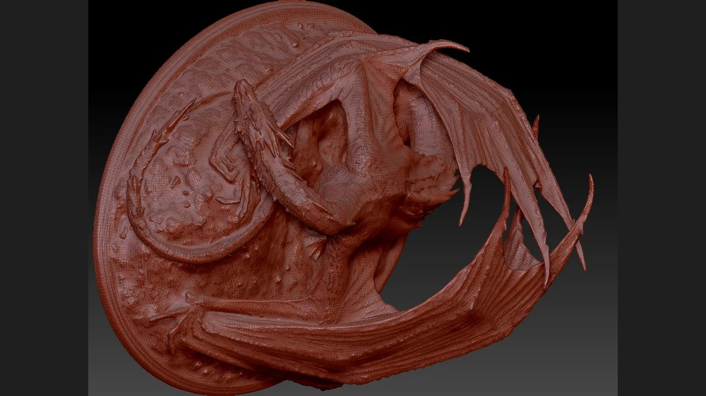

# The complete ZBrush MCP capability tour: 17 typed tools / 8 skills / 2 runtimes are contract-verified, and live 2027 host tool returns are explicitly not claimed



> The hero image is **retained historical evidence** from the `dcc-mcp-zbrush` README (real ZBrush 2026.2.0), re-encoded to JPEG from the original WebP payload with no cropping or content retouching. It is 1280 × 720 pixels. No new viewport capture, turntable or render was produced in this run.

This entry inventories the entire published ZBrush MCP surface: **17 typed tools** across **8 progressive skills**, **2 runtime modes** (embedded and sidecar), and **7 progressive loading stages** (**2** loaded by default). Of the tools, **6** are declared read-only and **11** destructive. A clean-wheel test suite passed **596** tests (**0** failed, **2** skipped) under CPython **3.12.10** with adapter **0.2.32** and core **0.20.52**; a reproducible tour verified all **17** tool contracts, their declared source files, their `next-tools` links and the published capability matrix (**3** checks `pass`, **1** honest `not_run` marker). **0** ZBrush MCP instances were live and **0** sidecar ports were open in this run, so no real `tools/call` return from a ZBrush **2027.0.1** GUI host is claimed. What is proven here is the *contract-complete inventory and its reproducibility*, not live host execution.

Artifacts: [README.md](README.md) · [README.zh.md](README.zh.md) · [capability_matrix.json](capability_matrix.json) · [capability_tour_result.json](capability_tour_result.json) · [reproduce_capability_tour.py](reproduce_capability_tour.py) · [hero-zbrush-dragon.jpg](hero-zbrush-dragon.jpg) · [validation.json](validation.json) · [manifest.json](manifest.json)

## What the capability tour covers

The ZBrush adapter exposes a thin-harness layer (bootstrap / diagnostics) and a domain layer (scene, subtool, brush, viewport, interchange, import, dialog recovery). Skills load progressively: `bootstrap` and `scene` are available by default, and the remaining stages load on demand through `load_skill(...)`. The table below is the full inventory — every tool, grouped by the stage that owns it. The machine-readable source of truth is [capability_matrix.json](capability_matrix.json), which is checked field-for-field against the shipped `tools.yaml` contracts.

| Stage | Skill | Typed tool | What it does | Annotations |
| --- | --- | --- | --- | --- |
| bootstrap | zbrush-scripting | `get_session_info` | Verify the MCP session, host version and active tool without changing the scene | read-only, idempotent |
| bootstrap | zbrush-scripting | `execute_python` | Escape hatch: run a short snippet inside ZBrush's embedded interpreter | destructive |
| scene | zbrush-scene | `get_scene_info` | Report the active tool path, subtool count and selected index | read-only, idempotent |
| scene | zbrush-scene | `list_subtools` | List every subtool with decoded visibility and lock flags | read-only, idempotent |
| authoring | zbrush-subtool | `select_subtool` | Activate a subtool by zero-based index | destructive, idempotent |
| authoring | zbrush-subtool | `get_subtool_status` | Read decoded visibility and lock flags | read-only, idempotent |
| authoring | zbrush-subtool | `inspect_active_mesh` | Machine-comparable point/face counts, bounds, area and solid state | read-only, idempotent |
| authoring | zbrush-subtool | `remesh_active_subtool` | Duplicate + native ZRemesher toward a bounded target face count | destructive |
| authoring | zbrush-subtool | `refine_active_subtool` | Bounded subdivision with optional Polish and Inflate | destructive |
| authoring | zbrush-subtool | `bake_active_subtool_map` | Atomically export one normal/displacement TIFF map | destructive, idempotent |
| authoring | zbrush-brush | `create_wrinkle_brush` | Author and save a DamStandard-based wrinkle crease brush (ZBP) | destructive, idempotent |
| authoring | zbrush-brush | `load_wrinkle_brush` | Load a wrinkle brush ZBP without a picker, reapply its settings | destructive, idempotent |
| presentation | zbrush-viewport | `capture_turntable` | Export one PSD document frame per Y-axis rotation angle, restore the transform | destructive, idempotent |
| interchange | zbrush-interchange | `export_active_subtool_obj` | Export the active subtool to OBJ on disk | destructive, idempotent |
| pipeline | zbrush-import-to-scene | `import_to_scene` | Import an OBJ asset described by an `AssetDescriptor`, adding a subtool | destructive |
| recovery | zbrush-dialog | `get_active_dialog` | Detect a blocking modal note and return OCR text, buttons and a screenshot path | read-only |
| recovery | zbrush-dialog | `click_dialog_button` | Click one labelled button on a blocking note and verify the bridge answers again | destructive |

The ordered, copyable-prompt demo chain covering every tool is the **12**-step sequence in [capability_matrix.json](capability_matrix.json) (`demo_step` and `copyable_prompt` per row). It runs from a session check and scene inspection, through selection, measurement, bounded refinement, map baking, brush authoring, turntable capture, OBJ export/import, dialog recovery, and finally the `execute_python` escape hatch. It is a script a real host can follow; it was **not** executed against a live ZBrush instance in this run.

## Runtime modes, loading stages and install lifecycle

Two runtime modes are supported. In **embedded** mode the MCP server runs inside ZBrush's own Python VM; in **sidecar** mode an external Python process talks over TCP to `mcp_socket_bridge.py` inside ZBrush. Both surface the same typed tools and the same progressive skill stages.

Install/verify is governed by a receipt-backed lifecycle SOP with **6** distinct exit codes, so a failed preflight cannot be mistaken for a successful install:

| Code | Meaning |
| --- | --- |
| `EXIT_OK` = 0 | verified success |
| `EXIT_PREFLIGHT` = 10 | preflight rejection |
| `EXIT_ACQUIRE` = 20 | payload acquisition failure |
| `EXIT_INSTALL` = 30 | install failure |
| `EXIT_VERIFY` = 40 | verification failure / rollback |
| `EXIT_REQUIRES_RESTART` = 50 | restart required |

Verification binds the exact ZBrush executable, PID, start identity, endpoint, version and loaded-module origins, and deliberately rejects a `PYTHONPATH`-shadowed adapter as not distribution-owned. Retained historical real-host evidence (kept separate from this run) confirms a Maxon-signed ZBrush 2026.2.0 host with **13** native regression checks passed, and a ZBrush 2027.0.1 host where `zbrush_info(0)` returned the version float and `zbrush_info(1)` the edition enum without folding the two together — so the identity fix produced no `EXIT_VERIFY` rollback. Neither historical run is re-executed here.

## Reproduction

Everything needed to re-check the inventory is in this directory; nothing below launches ZBrush or requires a GUI.

```bash
# From the dcc-mcp-zbrush checkout, with Python 3.10+ and PyYAML available:
python docs/showcase/zbrush-mcp-capability-tour/reproduce_capability_tour.py \
  --skills-root src/dcc_mcp_zbrush/skills
```

The script reads every bundled `tools.yaml`, confirms the declared source files exist and schemas are objects, resolves all `next-tools` references, and compares [capability_matrix.json](capability_matrix.json) against those contracts. It writes [capability_tour_result.json](capability_tour_result.json) with the measured counts, per-contract SHA-256 digests and a `verdict`. In this run it reported **17** tools across **8** skills with `verdict=pass`; its fourth check is an explicit `not_run` honesty marker stating that no live host call was executed.

To reproduce the test evidence instead, build a wheel from the checkout and run the full suite in a clean virtual environment (do **not** point `PYTHONPATH` at `src`, or the adapter's distribution-ownership guard will reject the import as a `PYTHONPATH`-shadowed module). The recorded result is **596** passed, **2** skipped, **0** failed. Run the official entry check from the `dcc-mcp/showcase` checkout:

```bash
python scripts/validate_entry.py docs/showcase/zbrush-mcp-capability-tour
```

Structural completion is reported as `PASS` for the three mandatory files ([README.md](README.md), [manifest.json](manifest.json), [validation.json](validation.json)) with hashes matching every artifact. A `PASS` here means the numbers are present and traceable, not that a live host produced them.

## Boundaries — what this entry does not prove

This is a **contract-verified capability tour**, anchored at the verification level `contract_verified_clean_wheel`. It is deliberately not a live-host demonstration. The following are recorded as `not_run` in [validation.json](validation.json), each with a concrete observed reason, and none is claimed:

- **Live 2027 host typed-tool returns.** No ZBrush process, no `zbrush` MCP instance and no open sidecar port were present; the 2027 host has no adapter/plugin deployment receipt. Real `tools/call` values for the **17** typed tools were not produced. This needs an owner-authorized deployment receipt, a GUI/document lease and a normal `zbrush` instance under the gateway's `/instances` before it can run.
- **UI-only operations.** Selection Sets, Bake Current and UV Apply/Cancel have **0** registered typed tools and no dedicated entry in the real `zbrush.commands` callable surface; GUI visibility is not SDK support, so no call was attempted. Only `bake_active_subtool_map` carries related bake/UV-map semantics.
- **New turntable media.** No live viewport was launched, so no new PSD/GIF/MP4 was captured; the hero is retained historical evidence, not a capture from this run.
- **Bilingual site build and publication.** The English/Chinese detail pages, locales, cover checks, `collection.json` / `unlisted-cases.json` decision, PR, merge, Pages deployment and live-page read-back all live in the separate `dcc-mcp/showcase` repository and were not executed from this adapter checkout.

Accordingly, the recorded publication decision is `unlisted_pending_real_host_evidence`. No formal approval, independent exact-head review, CI gate or release authorization was completed for this entry, and no private task ID, prompt, credential, internal path or unredacted log is included. The next step toward a gallery card is a real-host acceptance run with receipt-backed tool returns, followed by an authorized Draft PR to `dcc-mcp/showcase`, bilingual locales, a gallery decision, review, merge and a post-deploy read-back — each a separate authorization gate.
