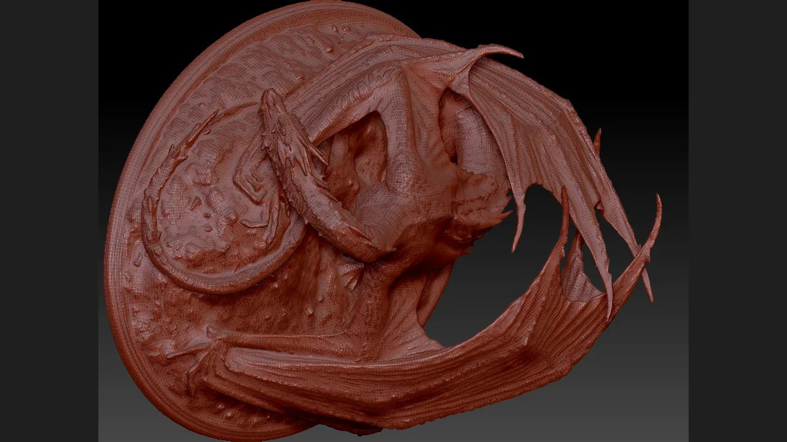

# ZBrush MCP 完整能力巡演：17 个类型化工具 / 8 个技能 / 2 种运行时均已通过契约校验，但 2027 真机工具返回明确不予声称



> 主图为 `dcc-mcp-zbrush` README 中**保留的历史真机证据**（真实 ZBrush 2026.2.0），由原始 WebP 载荷重新编码为 JPEG，未裁切、未修饰内容，尺寸 1280 × 720 像素。本轮**没有**产生任何新的视口截图、转盘动画或渲染。

本条目盘点 ZBrush MCP 已发布的全部能力：**8 个渐进式技能**下的 **17 个类型化工具**、**2 种运行时模式**（embedded 与 sidecar）、**7 个渐进加载阶段**（默认加载 **2** 个）。其中 **6** 个工具声明为只读、**11** 个为破坏性。在 CPython **3.12.10**、adapter **0.2.32**、core **0.20.52** 下，干净 wheel 测试套件通过 **596** 项（**0** 失败、**2** 跳过）；可复现巡演校验了全部 **17** 个工具契约、其声明的源文件、`next-tools` 引用与已发布的能力矩阵（**3** 项 `pass`、**1** 项诚实的 `not_run` 标记）。本轮在线的 ZBrush MCP 实例为 **0**、开放的 sidecar 端口为 **0**，因此**不声称**任何来自 ZBrush **2027.0.1** GUI 宿主的真实 `tools/call` 返回。此处证明的是**契约完整的能力清单及其可复现性**，而非真机执行。

文件：[README.md](README.md) · [README.zh.md](README.zh.md) · [capability_matrix.json](capability_matrix.json) · [capability_tour_result.json](capability_tour_result.json) · [reproduce_capability_tour.py](reproduce_capability_tour.py) · [hero-zbrush-dragon.jpg](hero-zbrush-dragon.jpg) · [validation.json](validation.json) · [manifest.json](manifest.json)

## 巡演覆盖的能力

ZBrush adapter 分为薄封装层（bootstrap / 诊断）与领域层（场景、子工具、笔刷、视口、交换、导入、对话框恢复）。技能渐进加载：`bootstrap` 与 `scene` 默认可用，其余阶段通过 `load_skill(...)` 按需加载。下表为完整清单——按所属阶段分组列出每个工具。机器可读的唯一事实来源是 [capability_matrix.json](capability_matrix.json)，它与随包的 `tools.yaml` 契约逐字段比对。

| 阶段 | 技能 | 类型化工具 | 作用 | 标注 |
| --- | --- | --- | --- | --- |
| bootstrap | zbrush-scripting | `get_session_info` | 校验 MCP 会话、宿主版本与当前工具，不改动场景 | 只读、幂等 |
| bootstrap | zbrush-scripting | `execute_python` | 逃生舱：在 ZBrush 内嵌解释器执行短片段 | 破坏性 |
| scene | zbrush-scene | `get_scene_info` | 返回当前工具路径、子工具数与选中索引 | 只读、幂等 |
| scene | zbrush-scene | `list_subtools` | 列出全部子工具及解码后的可见/锁定标志 | 只读、幂等 |
| authoring | zbrush-subtool | `select_subtool` | 按零基索引激活子工具 | 破坏性、幂等 |
| authoring | zbrush-subtool | `get_subtool_status` | 读取解码后的可见/锁定标志 | 只读、幂等 |
| authoring | zbrush-subtool | `inspect_active_mesh` | 可机比的点/面数、包围盒、面积与实体状态 | 只读、幂等 |
| authoring | zbrush-subtool | `remesh_active_subtool` | 复制后以有界目标面数运行原生 ZRemesher | 破坏性 |
| authoring | zbrush-subtool | `refine_active_subtool` | 有界细分，可选 Polish / Inflate | 破坏性 |
| authoring | zbrush-subtool | `bake_active_subtool_map` | 原子导出一张法线/置换 TIFF 贴图 | 破坏性、幂等 |
| authoring | zbrush-brush | `create_wrinkle_brush` | 基于 DamStandard 制作并保存褶皱笔刷（ZBP） | 破坏性、幂等 |
| authoring | zbrush-brush | `load_wrinkle_brush` | 不经选择器加载褶皱笔刷 ZBP 并复现参数 | 破坏性、幂等 |
| presentation | zbrush-viewport | `capture_turntable` | 按 Y 轴旋转逐角度导出 PSD 文档帧并还原变换 | 破坏性、幂等 |
| interchange | zbrush-interchange | `export_active_subtool_obj` | 将当前子工具导出为磁盘 OBJ | 破坏性、幂等 |
| pipeline | zbrush-import-to-scene | `import_to_scene` | 按 `AssetDescriptor` 导入 OBJ 资产并新增子工具 | 破坏性 |
| recovery | zbrush-dialog | `get_active_dialog` | 检测阻塞式模态提示，返回 OCR 文本、按钮与截图路径 | 只读 |
| recovery | zbrush-dialog | `click_dialog_button` | 点击阻塞提示的一个具名按钮并验证桥接恢复应答 | 破坏性 |

覆盖每个工具的、可复制提示词的有序演示链，是 [capability_matrix.json](capability_matrix.json) 中每行的 `demo_step` 与 `copyable_prompt` 组成的 **12** 步序列：从会话校验、场景查看，经选择、测量、有界细化、贴图烘焙、笔刷制作、转盘采集、OBJ 导出/导入、对话框恢复，最后到 `execute_python` 逃生舱。它是真机可照此执行的脚本，但本轮**未**对在线 ZBrush 实例执行。

## 运行时模式、加载阶段与安装生命周期

支持两种运行时模式。**embedded** 模式下 MCP server 运行在 ZBrush 自带 Python VM 内；**sidecar** 模式下由外部 Python 进程经 TCP 与 ZBrush 内的 `mcp_socket_bridge.py` 通信。两者暴露相同的类型化工具与相同的渐进技能阶段。

安装/校验由带回执的生命周期 SOP 管控，使用 **6** 个退出码，使失败的预检不会被误当作安装成功：

| 退出码 | 含义 |
| --- | --- |
| `EXIT_OK` = 0 | 校验通过 |
| `EXIT_PREFLIGHT` = 10 | 预检拒绝 |
| `EXIT_ACQUIRE` = 20 | 载荷获取失败 |
| `EXIT_INSTALL` = 30 | 安装失败 |
| `EXIT_VERIFY` = 40 | 校验失败 / 回滚 |
| `EXIT_REQUIRES_RESTART` = 50 | 需要重启 |

校验会绑定确切的 ZBrush 可执行文件、PID、启动标识、端点、版本与已加载模块来源，并刻意拒绝被 `PYTHONPATH` 遮蔽、不属于已安装发行包的 adapter。保留的历史真机证据（与本轮分开记录）确认：Maxon 签名的 ZBrush 2026.2.0 宿主通过 **13** 项原生回归检查；ZBrush 2027.0.1 宿主中 `zbrush_info(0)` 返回版本浮点数、`zbrush_info(1)` 返回版本枚举，二者不再被错误合并，因此身份修复未触发 `EXIT_VERIFY` 回滚。两次历史运行均未在本轮重跑。

## 复现

复核清单所需的一切都在本目录内，以下步骤**不会**启动 ZBrush、也**不需要** GUI。

```bash
# 在 dcc-mcp-zbrush 检出下，需 Python 3.10+ 与 PyYAML：
python docs/showcase/zbrush-mcp-capability-tour/reproduce_capability_tour.py \
  --skills-root src/dcc_mcp_zbrush/skills
```

脚本读取每个随包 `tools.yaml`，确认声明源文件存在、schema 为 object、解析全部 `next-tools` 引用，并将 [capability_matrix.json](capability_matrix.json) 与这些契约比对，写出 [capability_tour_result.json](capability_tour_result.json)（含实测计数、各契约 SHA-256 摘要与 `verdict`）。本轮结果为 **17** 个工具、**8** 个技能、`verdict=pass`；其第四项是明确的 `not_run` 诚实标记，说明未执行任何真机调用。

若需复现测试证据，请从检出构建 wheel 并在干净虚拟环境中运行完整套件（**不要**把 `PYTHONPATH` 指向 `src`，否则 adapter 的发行包归属守卫会把导入判为 `PYTHONPATH` 遮蔽而拒绝）。记录结果为 **596** 通过、**2** 跳过、**0** 失败。官方条目检查在 `dcc-mcp/showcase` 检出下运行：

```bash
python scripts/validate_entry.py docs/showcase/zbrush-mcp-capability-tour
```

三个强制文件（[README.md](README.md)、[manifest.json](manifest.json)、[validation.json](validation.json)）齐备、且各制品哈希一致时输出 `PASS`。此处的 `PASS` 仅表示数字齐备且可追溯，**不代表**真机产生过这些数字。

## 边界 —— 本条目不证明什么

这是一次**契约校验级的能力巡演**，验证级别为 `contract_verified_clean_wheel`，刻意**不是**真机演示。以下各项在 [validation.json](validation.json) 中记为 `not_run`、各附带具体的 `observed` 原因，且均不予声称：

- **2027 真机类型化工具返回。** 本轮没有 ZBrush 进程、没有 `zbrush` MCP 实例、也没有开放的 sidecar 端口；2027 宿主没有 adapter/插件部署回执。**17** 个类型化工具的真实 `tools/call` 值并未产生。需先取得属主授权的部署回执、GUI/文档租约，以及网关 `/instances` 下正常的 `zbrush` 实例，才能运行此项。
- **仅 UI 的操作。** Selection Sets、Bake Current 与 UV Apply/Cancel 的已注册类型化工具数为 **0**，在真实 `zbrush.commands` 可调用面中也没有专属入口；GUI 可见不等于 SDK 支持，因此未尝试调用。仅 `bake_active_subtool_map` 含相关的烘焙/UV 贴图语义。
- **新的转盘媒体。** 未启动在线视口，因此没有新的 PSD/GIF/MP4 采集；主图是保留的历史证据，不是本轮采集。
- **双语站点构建与发布。** 中英文详情页、语言包、封面检查、`collection.json` / `unlisted-cases.json` 决策、PR、合并、Pages 部署与线上页面回读，都位于独立的 `dcc-mcp/showcase` 仓库，未从本 adapter 检出执行。

因此记录的发布决策为 `unlisted_pending_real_host_evidence`。本条目**没有**完成任何正式批准、独立精确 head 审核、CI 门禁或发布授权，也**不含**任何私有的任务号、提示词、凭据、内部路径或未脱敏日志。通向画廊卡片的下一步是：一次带部署回执、含真实工具返回的真机验收运行，随后是经授权的 `dcc-mcp/showcase` Draft PR、双语语言包、画廊决策、审核、合并与部署后回读——每一道都是独立的授权门禁。
